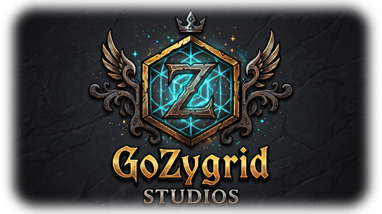
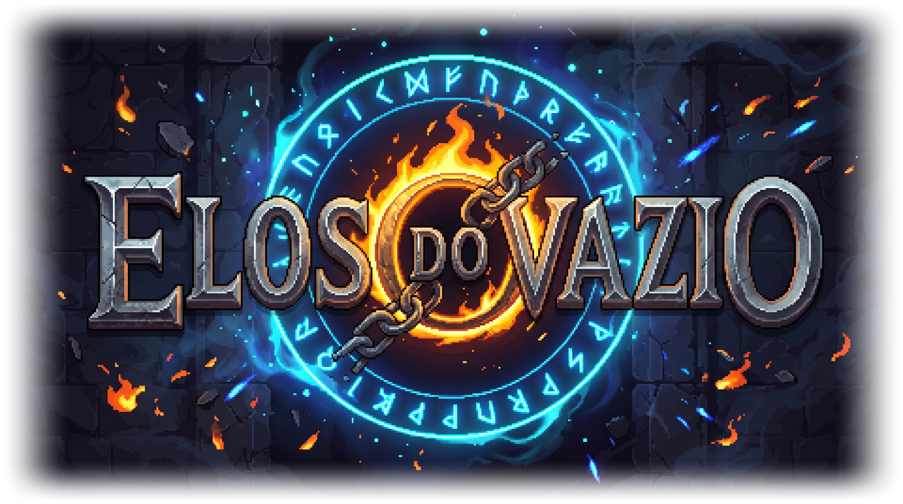
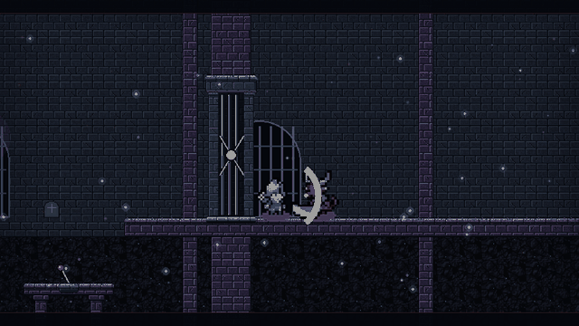
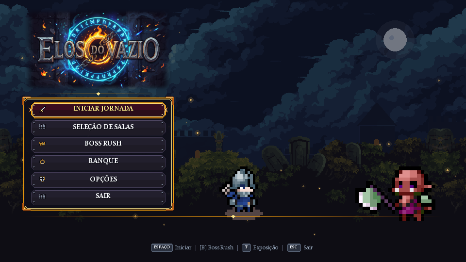
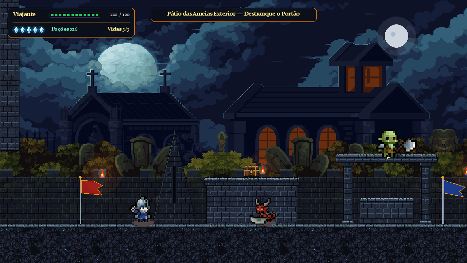
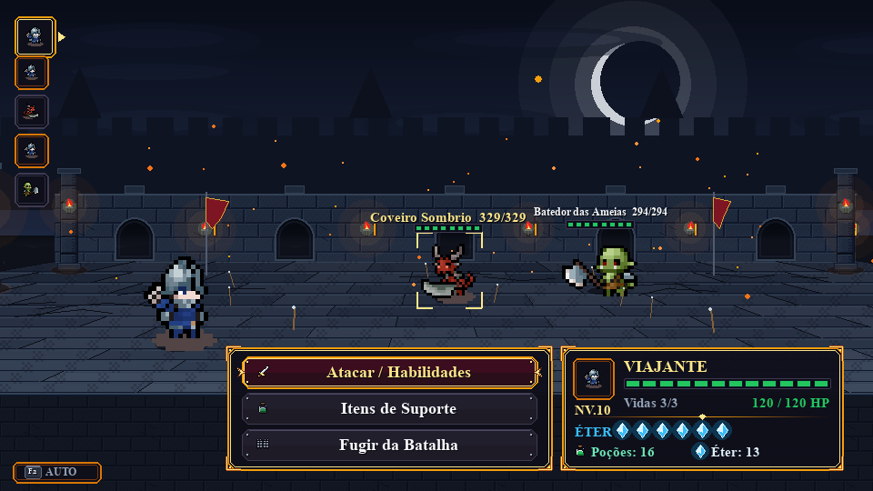
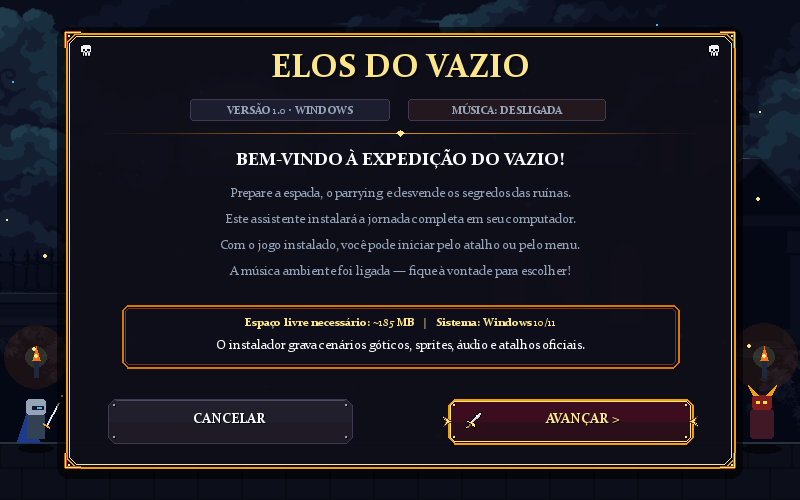

<div align="center">

  

  <br/>

  

  <h3>Plataforma 2D &amp; Combate Tático 2.5D Dark Fantasy em Python (<code>pygame-ce</code>)</h3>

  <p>
    <a href="#sobre-o-jogo">Sobre</a> •
    <a href="#galeria-do-jogo">Capturas</a> •
    <a href="#como-baixar-e-instalar">Como Baixar</a> •
    <a href="#guia-das-7-salas-da-masmorra">As 7 Salas</a> •
    <a href="#controles-essenciais">Controles</a> •
    <a href="#documentação-e-créditos">Documentação</a>
  </p>

  <p>
    <a href="https://github.com/GoKaio/elos-do-vazio/releases/latest/download/Instalador_Elos_do_Vazio.exe">
      
    </a>
    &nbsp;
    <a href="https://github.com/GoKaio/elos-do-vazio/releases">
      
    </a>
  </p>

  <p>
    <a href="https://github.com/GoKaio/elos-do-vazio/actions/workflows/ci.yml">
      
    </a>
    <a href="LICENSE">
      
    </a>
    
    
    
    
  </p>

  <br/>

  

  <br/>
  <sub><i>Prévia de gameplay em arena 2.5D: combate tático nas catacumbas, esquiva e Parry Perfeito com hitstop.</i></sub>

</div>

---

## Sobre o Jogo

**Elos do Vazio** é um jogo de ação, plataforma 2D e combate tático 2.5D desenvolvido pela **GoZygrid Studios** com auxílio de **Inteligência Artificial**. Ambientado em uma cidadela gótica arruinada pela queda dos selos de Éter, o Viajante deve cruzar **7 salas distribuídas em 4 biomas distintos**, destrancar portões de ferro por alavancas e chaves, dominar reações defensivas em tempo real (*Parry*, *Esquiva* e *Salto* sobre ondas sísmicas) e derrotar o guardião final.

### Principais Características
- **Abertura do Estúdio (`splash_estudio.py`):** sequência de entrada discreta com o emblema oficial da **GoZygrid Studios** antes do menu principal.
- **Combate Tático 2.5D com Reações em Tempo Real:** sistema por turnos com câmera dinâmica, janela de **QTE ofensivo (`[Z]`)**, **Parry Perfeito (`[X]`)** com *hitstop* de impacto e recuperação de Éter (+AP), **Esquiva (`[C]`)** e **Salto Defensivo (`[ESPAÇO]`)**.
- **7 Salas em 4 Biomas Temáticos (`gerenciador_salas.py`):** progressão de ameias exteriores sob luar, galerias com plataformas suspensas por correntes, catacumbas fechadas com plataformas móveis e a arena final do Guardião.
- **Renderização Procedural Gótica (`cenarios.py` & `cenario_combate_25d.py`):** cantaria autotiled 32x32 via `pygame.PixelArray`, pisos 2.5D com projeção cônica e perspectiva $1/Z$, tochas com halo suave `SRCALPHA` e efeitos de partículas.
- **Modos Especiais:** Campanha Completa, **Boss Rush** contínuo contra os 7 chefes, suporte completo a **Controles Xbox / PlayStation** e **Modo Bot Autônomo (`[F2]`)**.

---

## Galeria do Jogo

<table>
  <tr>
    <td align="center" width="50%">
      <br/>
      <sub><b>Menu Principal</b> — Interface gótica, seleção de salas, Boss Rush e ranking</sub>
    </td>
    <td align="center" width="50%">
      <br/>
      <sub><b>Exploração 2D (Sala 1)</b> — Pátio das Ameias, plataformas, alavancas e baús</sub>
    </td>
  </tr>
  <tr>
    <td align="center" width="50%">
      <br/>
      <sub><b>Combate Tático 2.5D</b> — Arena em perspectiva 1/Z, ordem de turnos, Éter e Parry</sub>
    </td>
    <td align="center" width="50%">
      <br/>
      <sub><b>Instalador Gótico Windows</b> — Assistente em 4 etapas com música tema e atalhos</sub>
    </td>
  </tr>
</table>

---

## Como Baixar e Instalar

### Opção 1 — Executável Pronto para Windows (Modo Jogador)

Para jogar diretamente no Windows **sem precisar instalar Python ou bibliotecas externas**:

1. Acesse a aba [**Releases**](https://github.com/GoKaio/elos-do-vazio/releases) (ou clique no botão **Baixar Instalador Windows** no topo deste README).
2. Baixe o arquivo **`Instalador_Elos_do_Vazio.exe`** e execute-o com dois cliques.
3. Siga as **4 etapas do instalador gótico** até concluir:

| Etapa | O que faz |
| :--- | :--- |
| **Etapa 1 · Boas-Vindas** | Apresenta a moldura Dark Fantasy, versão e controle de música ambiente em loop; clique em **`AVANÇAR >`**. |
| **Etapa 2 · Diretório & Opções** | Permite editar o caminho padrão (`C:\Jogos\Elos do Vazio`), escolher outra pasta e marcar criação de atalhos. |
| **Etapa 3 · Instalação Ativa** | Descompacta o jogo em *thread* separada com barra segmentada em ciano de Éter e badalo de sino nos 100%. |
| **Etapa 4 · Conclusão & Atalhos** | Cria atalhos **`.lnk`** automáticos na **Área de Trabalho** e no **Menu Iniciar** e libera o botão **`JOGAR AGORA`**. |

### Opção 2 — Baixar e Rodar via Código-Fonte (Modo Desenvolvedor)

Requer **Python 3.10+** (recomendado **Python 3.12**) e Git instalados no Windows (ou baixe diretamente pelo botão **`Code → Download ZIP`** no topo da página):

```powershell
# 1. Clonar o repositório e entrar na pasta
git clone https://github.com/GoKaio/elos-do-vazio.git
cd elos-do-vazio

# 2. Criar e ativar o ambiente virtual
python -m venv venv
venv\Scripts\activate

# 3. Instalar dependências
pip install -r requirements.txt

# 4. Iniciar o jogo
python main.py
```

> **Atalho rápido no Windows:** após clonar ou extrair o `.zip`, você pode dar dois cliques em **`INSTALAR_DEPENDENCIAS.bat`** e depois em **`JOGAR.bat`**.

---

## Guia das 7 Salas da Masmorra

| Sala | Nome da Câmara | Bioma | Guardião / Chefe | Mecânicas e Elementos |
| :---: | :--- | :--- | :--- | :--- |
| **1** | **Pátio das Ameias** | Ameias e Pátio Superior | Guardião do Cemitério | Exterior noturno, lua cheia, mastros com bandeiras e alavanca da guarita. |
| **2** | **Ameias Superiores** | Ameias e Pátio Superior | Ente da Árvore Torta | Patamares em 3 alturas crescentes, vãos de muralha e armadilhas de veneno. |
| **3** | **Galeria da Torre** | Galerias das Torres de Vigia | Carcereiro dos Portões | Torres em paralaxe, degraus rebaixados, chaves e portão ancorado ao pátio leste. |
| **4** | **Torre de Vigia Suspensa** | Galerias das Torres de Vigia | Zelador do Mausoléu | Passarelas suspensas por correntes sobre o fosso e rotas bilaterais de retorno. |
| **5** | **Catacumbas Subterrâneas** | Cripta e Catacumbas | Sentinela de Pedra | Teto fechado em cantaria escura, grades de ferro, lápides, arcos e tochas frias. |
| **6** | **Cripta dos Ossos** | Cripta e Catacumbas | Rei da Lua Sangrenta | Plataformas móveis mecanizadas sobre trilhos e fossos com espinhos estreitos. |
| **7** | **Santuário do Guardião** | Santuário do Guardião | Bibliotecário do Vazio | Arena plana monumental (960 px), pilares com estátuas, 3 relíquias de Éter e Portão Titânico Rúnico. |

---

## Controles Essenciais

| Contexto | Ação | Teclado | Controle (Xbox / PS) |
| :--- | :--- | :--- | :--- |
| **Exploração** | Mover / Saltar | `A`/`D` ou Setas • `ESPAÇO` / `W` | Analógico / D-Pad • `A` / Cruz |
| **Exploração** | Interagir / Pausa | `E` / `ENTER` • `ESC` | `X` / Quadrado • `START` |
| **Combate (Turno)** | Menu / Trocar Alvo | Setas • `ENTER` / `Z` • `A`/`D` | D-Pad • `A` • `LB`/`RB` |
| **Combate (Reação)** | **Parry Perfeito** | `X` | `X` / Quadrado |
| **Combate (Reação)** | **Esquivar / Pular Onda** | `C` • `ESPAÇO` | `B` / Círculo • `A` / Cruz |
| **Utilitários** | Bot Autônomo / Tela Cheia | `F2` • `F11` | `Y` / Triângulo (Bot) |

---

## Compilação e Ferramentas Avançadas

<details>
<summary><b>Clique para expandir: compilação do executável (.exe), instalador e geração de mídia/PDFs</b></summary>

### Compilação via PyInstaller (Windows)
```powershell
# Automação completa (.bat): instala deps, compila o jogo e empacota o instalador
.\build_tudo.bat
```
Ou diretamente via Python:
```powershell
pip install pyinstaller pillow pygame-ce
python build_instalador.py --all            # Gera dist/Elos_do_Vazio/ + dist_installer/Instalador_Elos_do_Vazio.exe
python build_instalador.py --only-installer # Reempacota apenas o instalador
python build_exe.py                         # Compila somente o executável do jogo
```

### Ferramentas de Mídia e Documentação
| Script | Finalidade | Saída Gerada |
| :--- | :--- | :--- |
| `gerar_trailer.py` | Renderiza trailer cinematográfico 1920x1080 @ 60 FPS com áudio | `trailer_elos_do_vazio.mp4` |
| `converter_trailer_gif.py` | Extrai trecho de combate otimizado em GIF 640px para GitHub | `assets/trailer_preview.gif` |
| `gerar_documentos_pdf.py` | Gera os PDFs editoriais (Exposição e Manual Técnico GitHub) | `elos_do_vazio_exposicao.pdf` / `elos_do_vazio_guia_github.pdf` |

</details>

---

## Estrutura do Repositório

```text
elos-do-vazio/
├── .github/                      # Workflows CI (Actions) e templates de Issue / PR
├── docs/screenshots/             # Capturas reais do menu, exploração, combate 2.5D e instalador
├── assets/                       # Logos, sprites, trilha/SFX (.ogg) e preview GIF
├── main.py                       # Loop principal (960x540 SCALED), física 2D e estados
├── splash_estudio.py             # Abertura discreta da GoZygrid Studios ao iniciar o jogo
├── menu.py                       # Menu principal, seleção de salas, perfil e ranking
├── gerenciador_salas.py          # Construtores das 7 salas, 4 biomas e loader Legacy-Dungeon
├── cenarios.py                   # Tileset autotile 32x32 (PixelArray), paralaxe, tochas e portões
├── combate.py                    # Sistema tático por turnos, QTE, parry, hitstop e câmera
├── cenario_combate_25d.py        # Arena 2.5D com projeção cônica e piso 1/Z
├── sprites.py                    # Loader/animador modular de sprites e combatentes
├── instalador_gui.py             # Instalador gráfico 800x500 com música e atalhos .lnk
├── build_instalador.py           # Orquestrador de payload ZIP + Instalador PyInstaller
├── build_exe.py                  # Gerador de ícone .ico e compilação PyInstaller do jogo
├── build_tudo.bat                # Automação completa Windows (deps + exe + instalador)
├── elos_do_vazio_guia_github.pdf # Manual Técnico GitHub & Instalação (PDF)
├── elos_do_vazio_exposicao.pdf   # Painel Editorial de Exposição (PDF)
├── CHANGELOG.md                  # Histórico de versões
├── CONTRIBUTING.md               # Guia de contribuição e testes headless
├── LICENSE                       # Licença MIT (código-fonte) e notas de assets
└── requirements.txt              # Dependências Python (pygame-ce>=2.5.0)
```

---

## Documentação e Créditos

- 📄 [**Manual Técnico GitHub & Instalação (`elos_do_vazio_guia_github.pdf`)**](elos_do_vazio_guia_github.pdf) — guia ilustrado em PDF de página única.
- 📄 [**Painel Editorial de Exposição (`elos_do_vazio_exposicao.pdf`)**](elos_do_vazio_exposicao.pdf) — ficha técnica e vitrine dos 4 biomas.
- 📜 [**Histórico de Versões (`CHANGELOG.md`)**](CHANGELOG.md) • [**Guia de Contribuição (`CONTRIBUTING.md`)**](CONTRIBUTING.md)
- 🎵 **Áudio e SFX:** créditos detalhados em [`assets/audio/CREDITOS_AUDIO.txt`](assets/audio/CREDITOS_AUDIO.txt) (Flare RPG / FantasyCore — CC-BY-SA 3.0 / CC0).
- 🤖 **Desenvolvimento:** projeto desenvolvido pela **GoZygrid Studios** com auxílio de **Inteligência Artificial**.
- ⚖️ **Licença:** código-fonte Python sob licença [**MIT**](LICENSE).

<div align="center">
  <br/>
  <sub>Desenvolvido por <b>GoZygrid Studios</b> com auxílio de Inteligência Artificial — Projeto <b>Elos do Vazio</b></sub>
</div>
